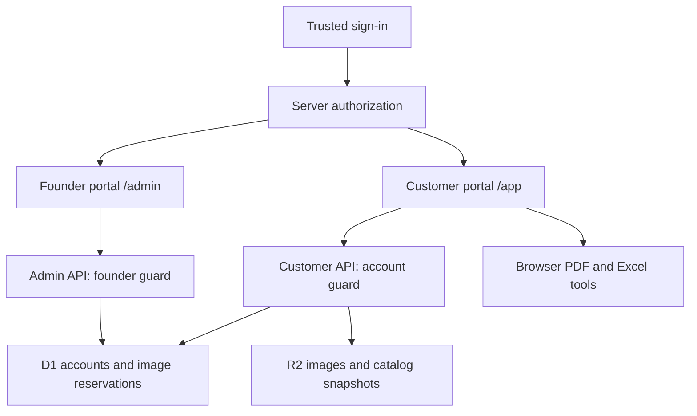

# System architecture and functional requirements

## Delivered architecture

One repository and one hosted application contain two separate portals. This is route/module separation, not two independent deployed servers.

| Boundary | Entry | Implementation | Access |
| --- | --- | --- | --- |
| Founder chooser | `/` | `app/page.tsx` | Founder sees both portals; other signed-in users redirect to `/app` |
| Customer app | `/app` | `features/customer/components/` | Authenticated account; owns its catalogs/images |
| Founder admin | `/admin` | `features/admin/components/` | Server-guarded by `app/admin/layout.tsx` |
| Admin API | `/api/admin/*` | `app/api/admin/` | Each handler independently checks founder identity |
| Customer API | `/api/account`, `/api/workspace`, `/api/media` | `app/api/` | Account-scoped server authorization |
| Shared UI | `/plans` and plan displays | `features/shared/components/`, `components/ui/` | Contains no administrative mutation controls |

`lib/server/account.ts` owns authorization, D1/R2 access and request guards. `lib/auth/access-policy.ts` defines the fail-closed founder email match. Founder identity is server configuration, never a profile role or client checkbox. The customer client imports no admin dashboard modules and has no admin navigation. The founder uses `/` or bookmarks to access both portals.

React/TypeScript uses Next App Router conventions on Vinext/Cloudflare. Catalog metadata is saved as account-scoped R2 JSON snapshots; uploaded images are private R2 objects; D1 records account membership, plan allowances and atomic image reservations. IndexedDB provides a recovery copy and account-scoped device preferences. Cloud snapshot writes are last-save-wins; collaborative conflict merging is not implemented.

See [Admin and billing](ADMIN-AND-BILLING.md) for quota behavior and payment integration boundaries.

## Entities

| Entity | Key data |
|---|---|
| Catalog | UUID, name, product array, brand settings, updated timestamp |
| Product | UUID, string item code, name, category, translated description, pack, string UPC, price, stock, brand, tags, active, image, optional source page |
| Brand | Company name, cover title/subtitle, address, phone, email, website, logo, accent color |
| Backup | Version 1 envelope, catalog array, embedded image data |
| Import | Workbook, selected worksheet, zero-based header row, field-to-column mapping, validation issues |
| Export | Current filtered/selected products, visible fields, card density, cover and index switches |

## Functional requirements and implemented behavior

| ID | Requirement | Acceptance behavior |
|---|---|---|
| FR-01 | Spreadsheet import | XLS/XLSX/CSV up to 25 MB; choose sheet and header row; auto-suggest mappings and allow changes |
| FR-02 | Data validation | Require item code and name; skip duplicate source codes; reject malformed prices and stock; show skipped-row reasons |
| FR-03 | Incremental update | Case-insensitive item-code upsert; retain images, unmapped fields, and blank-valued existing fields; retain products absent from file |
| FR-04 | Product management | Create, edit, delete, set active state; prevent duplicate item codes |
| FR-05 | Product images | PNG/JPEG/WebP up to 10 MB; validate decoding, preserve original resolution/format and private uploaded media reference |
| FR-06 | Filtering | Text search across name/code/description/UPC/brand; category, active state, image presence, tags, in-stock toggle |
| FR-07 | Product selection | Select individual products or all filtered records; optionally export only selection |
| FR-08 | Branding | Custom logo or default Nova logo, accent color, contact details, title/subtitle; live cover preview |
| FR-09 | PDF export | Download Letter portrait PDF with optional cover, paginated category index, 9/16 product cards per page, footer numbers |
| FR-10 | Field control | Show/hide images, codes, descriptions, packs, barcodes, prices, stock, and brands; name always visible |
| FR-11 | Account persistence | Cloud snapshot autosave, private image storage and IndexedDB recovery; loading/saving/success/failure status |
| FR-12 | Catalog management | Create empty collection, duplicate, switch, rename, and delete; preserve at least one catalog |
| FR-13 | Backup/restore | Download all collections with images in one JSON file; validate and restore as additional copies |
| FR-14 | Source quick start | PDF starter with 1,410 records and Excel starter with 1,031 records; source-based logo and contacts |
| FR-15 | Source delivery | Download application source, setup guide, architecture, and tests from the app |

| FR-16 | Start over | Settings provides a catalog selector, optional branding retention, backup shortcut, and typed CLEAR confirmation; clears all products including filtered-out records, resets selection/filters, and autosaves an empty catalog without reloading starter data |

| FR-17 | User profile | Upload/remove a validated raster avatar; edit display name, company, contact email/phone, role, bio and workspace name; explicit Save/Discard; sidebar reflects saved identity |
| FR-18 | Preferences | Default grid/list view, 24/48/96 records per page, startup page, PDF density and cover/index defaults, optional success toasts; errors remain visible; reset preferences retains identity |
| FR-19 | Settings persistence | Separate IndexedDB settings key; safe normalization on load/restore; backups include settings; opt-in restoration with compatibility for older backups; catalog wipe preserves profile |

| FR-20 | Bulk image upload | Multi-file/ZIP input, code-first then normalized exact name matching, paginated preview and manual reassignment, explicit replacement toggle, duplicate-target prevention, batch image validation before applying |
| FR-21 | Bulk image download | All/filtered/selected scope, ZIP with code/name filenames and JSON mapping, image-less products skipped, mapping supports subsequent re-upload |

Bulk image code is in `features/customer/components/image-manager.tsx` and `lib/image-matching.ts`. ZIP work uses fflate in the browser. Files are read in memory; archive paths are never written to the filesystem. Upload limits bound per-file, batch, and expanded ZIP size. Ambiguous matching produces no automatic target. Product IDs identify manual assignments; item codes provide portable ZIP mappings.

| FR-22 | App color themes | Seven palettes including dark mode; immediate application and automatic saving on selection, independent of unsaved profile edits; failed saves roll back; IndexedDB and backup persistence; older settings default to Sage; app-scoped tokens preserve PDF branding |

| FR-23 | Library barcodes | Generate CODE128 SVG for each populated UPC/barcode field; grid/list display, enlarged scan dialog, live editor preview, updates after imports/edits; blank and unsupported values show explicit states |

## Import rules

Header detection searches the first 30 rows for Item Code, SKU, or Product Code. Mapping can be corrected manually. SheetJS formatted cell text preserves string identifiers and number formats such as leading zeroes when present in the workbook; leading zeroes already lost in an unformatted numeric spreadsheet cannot be recovered. Prices and stock accept dollar signs and grouping commas. List price uses USD presentation. No exchange-rate conversion or locale-specific decimal inference is implemented.

Products missing from an import are retained. Empty cells do not clear existing fields; clear a value in the product editor. Duplicates within an incoming sheet keep the first valid record and report subsequent records. Embedded Excel photographs are not extracted; upload images in the product editor. Spreadsheet imports do not match images by product name; the separate bulk-image tool supports exact normalized name matching.

## Export rules

All current UI filters affect export. Categories retain first-seen order. Products retain source/import order within each category. Every category starts on a new page. Index page numbers are derived from the same page plan used to render product pages, including cover/index offsets. An index page holds 24 category entries.

Each output page is rendered separately before adding it to the PDF document, reducing canvas memory pressure. The full PDF still consumes browser memory. Extremely long product text can exceed a fixed card: the export reports overflow and asks for the 9-card layout or fewer fields instead of silently cutting content. Barcodes render the provided digits as CODE128; output is not a UPC validation service. The exact old PDF layout is not pixel-recreated: the app creates an editable branded layout with the same information types.

## Privacy and resilience

Excel parsing and PDF rendering remain browser-side. Uploaded images and catalog metadata are saved to the authenticated account. API authorization scopes reads, writes and deletes to that account; founder administration uses a separate server guard. Browser storage is never an authorization source. Uploaded images are limited to raster types. Restored embedded images are uploaded and validated before cloud snapshot save.

The hosted preview remains owner-private. Adding customer records does not change Site sharing. The public GitHub repository contains source and approved samples, not runtime account data or credentials.

## Current limitations

- Real billing is not connected; manual access status is not proof of payment.
- Customer launch needs deliberate Site sharing or equivalent verified production authentication on another host.
- Bare deployment of the trusted-header adapter outside the Sites gateway is not supported. Replace it with verified authentication before public exposure.
- Profile settings remain device-local; cloud catalog writes use last-save-wins.
- Browser/physical-scanner verification has not been completed.
- Desktop packaging and automated arbitrary PDF extraction are not implemented.

PDF quality: 300-DPI page rasterization with high-quality JPEG encoding; CODE128 barcodes are overlaid as PDF vector rectangles and text. Cooperative AbortController checkpoints discard cancelled output before saving; a running canvas render completes before cancellation is acknowledged.

## Catalog style survey
Open **Customer app → Brand & cover → Find your catalog style**. The ten-question survey covers industry, audience, goal, range size, layout, required fields, photos, typography, palette and viewing format. Back/Next preserves current answers; Close without applying leaves the saved design intact. Applying a recommendation saves the answers and design with that catalog, including cloud recovery and backups. Reopen to review or retake it.

Three recommendations offer cover, product and index previews using existing products. Customize layout, fonts, palette and Letter/A4 before applying. Six implemented PDF layouts: four-card showcase, nine-card balanced, sixteen-card wholesale, one-product editorial, three wide technical panels, and mixed (one hero page per category followed by nine-card grids). Specifications/benefits use the existing description field; this does not add variant, MOQ, discount or comparison-table data models. Technical panels are not automatic specification comparison tables. Layout thumbnails are illustrative, not exact PDF proofs.

Five Google Fonts pairings are requested from Google Fonts; installed fallback fonts are used if those resources are unavailable. The app waits for selected fonts before export. Five palette presets plus the existing brand color are available. App UI themes remain independent of PDF design. Larger layouts preserve high-resolution rendering, vector barcodes and export cancellation. Source photos determine actual image detail.

Implementation: `lib/catalog-style.ts` defines questions, validated settings and deterministic recommendations; `features/customer/components/catalog-style-survey.tsx` presents the survey and previews; `lib/pdf-export.ts` implements designs. No external AI or paid template service is used. Recommendation tests, persistence validation and mixed-layout pagination tests live in `tests/catalog-style.test.ts`. Browser visual verification remains outstanding.
