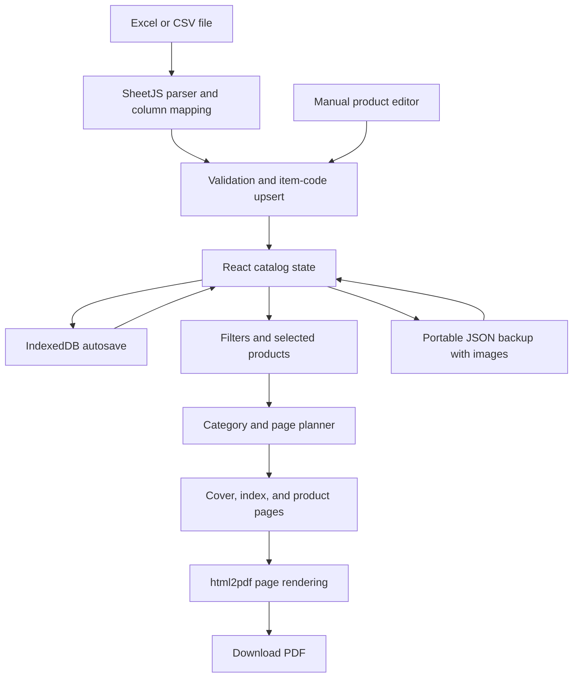

# System architecture and functional requirements

## Delivered architecture

The UI is a Next.js App Router-style client application served by the Vinext Cloudflare runtime. Business data is held locally. Starter assets are hosted with the application; runtime products are not sent to a server. React state drives views, IndexedDB saves complete catalog snapshots, and downloadable backups provide PC-folder portability. No background sync or multi-user collaboration is implemented.

## Entities

| Entity | Key data |
|---|---|
| Catalog | UUID, name, product array, brand settings, updated timestamp |
| Product | UUID, string item code, name, category, translated description, pack, string UPC, price, stock, brand, tags, active, image, optional source page |
| Brand | Company name, cover title/subtitle, address, phone, email, website, logo, accent color |
| Backup | Version 1 envelope, catalog array, embedded image data |
| Import | Workbook, selected worksheet, zero-based header row, field-to-column mapping, validation issues |
| Export | Current filtered/selected products, visible fields, card density, cover and index switches |

## Functional requirements and implemented behavior

| ID | Requirement | Acceptance behavior |
|---|---|---|
| FR-01 | Spreadsheet import | XLS/XLSX/CSV up to 25 MB; choose sheet and header row; auto-suggest mappings and allow changes |
| FR-02 | Data validation | Require item code and name; skip duplicate source codes; reject malformed prices and stock; show skipped-row reasons |
| FR-03 | Incremental update | Case-insensitive item-code upsert; retain images, unmapped fields, and blank-valued existing fields; retain products absent from file |
| FR-04 | Product management | Create, edit, delete, set active state; prevent duplicate item codes |
| FR-05 | Product images | PNG/JPEG/WebP up to 10 MB; normalize to a maximum 1,000-pixel dimension and JPEG data URL |
| FR-06 | Filtering | Text search across name/code/description/UPC/brand; category, active state, image presence, tags, in-stock toggle |
| FR-07 | Product selection | Select individual products or all filtered records; optionally export only selection |
| FR-08 | Branding | Custom logo or default Nova logo, accent color, contact details, title/subtitle; live cover preview |
| FR-09 | PDF export | Download Letter portrait PDF with optional cover, paginated category index, 9/16 product cards per page, footer numbers |
| FR-10 | Field control | Show/hide images, codes, descriptions, packs, barcodes, prices, stock, and brands; name always visible |
| FR-11 | Local persistence | IndexedDB autosave with loading/saving/success/failure status |
| FR-12 | Catalog management | Create empty collection, duplicate, switch, rename, and delete; preserve at least one catalog |
| FR-13 | Backup/restore | Download all collections with images in one JSON file; validate and restore as additional copies |
| FR-14 | Source quick start | PDF starter with 1,410 records and Excel starter with 1,031 records; source-based logo and contacts |
| FR-15 | Source delivery | Download application source, setup guide, architecture, and tests from the app |

| FR-16 | Start over | Settings provides a catalog selector, optional branding retention, backup shortcut, and typed CLEAR confirmation; clears all products including filtered-out records, resets selection/filters, and autosaves an empty catalog without reloading starter data |

| FR-17 | User profile | Upload/remove a normalized raster avatar; edit display name, company, contact email/phone, role, bio and workspace name; explicit Save/Discard; sidebar reflects saved identity |
| FR-18 | Preferences | Default grid/list view, 24/48/96 records per page, startup page, PDF density and cover/index defaults, optional success toasts; errors remain visible; reset preferences retains identity |
| FR-19 | Settings persistence | Separate IndexedDB settings key; safe normalization on load/restore; backups include settings; opt-in restoration with compatibility for older backups; catalog wipe preserves profile |

| FR-20 | Bulk image upload | Multi-file/ZIP input, code-first then normalized exact name matching, paginated preview and manual reassignment, explicit replacement toggle, duplicate-target prevention, batch image validation before applying |
| FR-21 | Bulk image download | All/filtered/selected scope, ZIP with code/name filenames and JSON mapping, image-less products skipped, mapping supports subsequent re-upload |

Bulk image code is in `components/image-manager.tsx` and `lib/image-matching.ts`. ZIP work uses fflate in the browser. Files are read in memory; archive paths are never written to the filesystem. Upload limits bound per-file, batch, and expanded ZIP size. Ambiguous matching produces no automatic target. Product IDs identify manual assignments; item codes provide portable ZIP mappings.

| FR-22 | App color themes | Seven palettes including dark mode; immediate application and automatic saving on selection, independent of unsaved profile edits; failed saves roll back; IndexedDB and backup persistence; older settings default to Sage; app-scoped tokens preserve PDF branding |

| FR-23 | Library barcodes | Generate CODE128 SVG for each populated UPC/barcode field; grid/list display, enlarged scan dialog, live editor preview, updates after imports/edits; blank and unsupported values show explicit states |

## Import rules

Header detection searches the first 30 rows for Item Code, SKU, or Product Code. Mapping can be corrected manually. SheetJS formatted cell text preserves string identifiers and number formats such as leading zeroes when present in the workbook; leading zeroes already lost in an unformatted numeric spreadsheet cannot be recovered. Prices and stock accept dollar signs and grouping commas. List price uses USD presentation. No exchange-rate conversion or locale-specific decimal inference is implemented.

Products missing from an import are retained. Empty cells do not clear existing fields; clear a value in the product editor. Duplicates within an incoming sheet keep the first valid record and report subsequent records. Embedded Excel photographs are not extracted; upload images in the product editor. Images are not matched by product name.

## Export rules

All current UI filters affect export. Categories retain first-seen order. Products retain source/import order within each category. Every category starts on a new page. Index page numbers are derived from the same page plan used to render product pages, including cover/index offsets. An index page holds 24 category entries.

Each output page is rendered separately before adding it to the PDF document, reducing canvas memory pressure. The full PDF still consumes browser memory. Extremely long product text can exceed a fixed card: the export reports overflow and asks for the 9-card layout or fewer fields instead of silently cutting content. Barcodes render the provided digits as CODE128; output is not a UPC validation service. The exact old PDF layout is not pixel-recreated: the app creates an editable branded layout with the same information types.

## Privacy and resilience

Uploaded workbooks and images are processed locally in the browser. The hosted site is initially owner-private. IndexedDB is scoped to the host and browser profile. It is not encrypted storage or a multi-user authorization layer. Catalog backup files contain product data and images. No secret keys belong in browser code. Rendering escapes user text before placing it into export HTML. Restored image sources are restricted to bundled paths or normalized raster data URLs.

## Optional cloud phase — not connected in this version

A future cloud backend can replace the persistence adapter with authenticated document storage while leaving import, editor, filter, and export components intact. Supabase is one possible provider; no project, tables, policies, or credentials are configured by this application. Before implementing that phase, define ownership, sharing, image limits, and conflict behavior. Minimum work:

1. Add account authentication and a user-owned catalog data model.
2. Store image binaries in private object storage and reference them by immutable IDs.
3. Enforce owner access at the database and object-storage layers.
4. Add version numbers or updated-at checks for conflicting edits.
5. Implement upload/download sync with retry and explicit local/cloud status.
6. Provide a migration that imports existing downloaded backups.
7. Test cross-account isolation, expired sessions, offline edits, and conflict recovery.

PC-folder saving is currently handled by browser downloads and backup restore. A packaged Windows desktop version could use a file-backed adapter but is not part of this delivery.
